<div align="center">


# Logen

### The membership NFT that carries its own wallet

**Sell the seat and the wallet goes with it. The seller cannot keep a single key.**

<sub><i>Keanggotaan yang diwariskan bersama isinya.</i></sub>

<br>


[**Live demo**](https://logen-seat-tan.vercel.app/) · [Attack Lab](https://logen-seat-tan.vercel.app/lab) · [Threat model](./docs/THREAT_MODEL.md) · [Contract API](./docs/API.md) · [Testnet deployment](./docs/deployment.testnet.json)

<br>

<a href="https://logen-seat-tan.vercel.app/">
  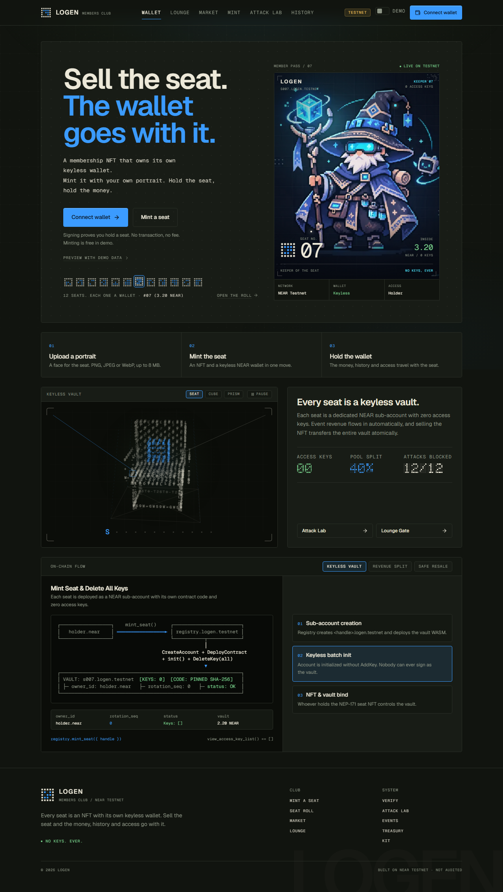
</a>

</div>

---

**Contents:**
[In 30 seconds](#logen-in-30-seconds) ·
[Problem and approach](#the-problem-and-the-approach) ·
[Track 10 map](#track-10-fit-and-requirement-map) ·
[Verify it yourself](#verify-it-yourself) ·
[Live deployment](#live-near-testnet-deployment) ·
[How it works](#how-it-works) ·
[Threat model](#threat-model-and-attack-lab) ·
[Web app](#web-application) ·
[Repo layout](#repository-layout-and-build-artifacts) ·
[Verification ladder](#third-party-verification-ladder) ·
[Limitations](#limitations-and-scope) ·
[Roadmap](#roadmap) ·
[Compliance](#hackathon-compliance-and-disclosures) ·
[Glossary](#glossary)

> **Reviewing quickly?** Run the one-minute on-chain check in [Level 1](#level-1-on-chain-proof-no-clone), then `make judge` from [Level 2](#level-2-full-local-run), then open the [Attack Lab](https://logen-seat-tan.vercel.app/lab). Each claim in this README is mapped to its evidence in the [claim-to-evidence table](#claim-to-evidence-map).

---

## Logen in 30 seconds

Logen is a members club on NEAR. Each **seat** is an NEP-171 NFT and, at the same time, a real NEAR sub-account that holds its own NEAR balance and receives its share of club revenue. Whoever holds the NFT controls that account. When a seat is sold, ownership, balance and access move to the buyer in one receipt. The seller keeps nothing, because the account never had an access key to keep.

| | |
| --- | --- |
| **Product** | A members club where a seat is an NFT plus a keyless sub-account wallet. Seats earn a share of event-ticket revenue, can be traded on a safe secondary market, and unlock a holder-only lounge. |
| **Problem solved** | Wallet-NFTs that pass control by swapping access keys cannot be trusted on resale. A contract cannot list the keys on its own account, so a seller can plant a key or drain the wallet before the sale. |
| **Core idea** | **Zero access keys.** Seat sub-accounts are created without `AddKey`, the parent registry is sealed with `DeleteKey`, and control lives in contract state (`owner_id`, `rotation_seq`) that moves atomically. |
| **Track** | `nfts`: NFTs That Do Something |
| **NEAR features used** | Sub-accounts; NEP-171 with NEP-297 events; atomic batch receipts (`CreateAccount` → `Transfer` → `DeployContract` → `FunctionCall`); cross-contract calls and callbacks; `DeleteKey` to seal the parent; NEP-413 message signing for wallet sign-in; RPC `view_access_key_list` and `view_account` as public proofs; `nft_item_info()` from the Sharded NFT Items draft. |
| **Status** | Deployed to NEAR Testnet and exercised end to end: mint, ticket sale, revenue claim, list, buy, four live attack attempts, parent seal. Testnet only. Not audited. |
| **Live demo** | https://logen-seat-tan.vercel.app/ |
| **Fastest check** | One `curl` loop, see [Level 1](#level-1-on-chain-proof-no-clone) |
| **Full check** | `make judge` (Rust tests, wasm build, Vitest), then `make attack` |

---

## The problem and the approach

### The problem

Most "NFT wallets" transfer control by adding an access key for the buyer and deleting the seller's key. On NEAR that pattern breaks on resale: **a smart contract cannot enumerate the access keys on its own account**. A seller can plant an extra `FullAccess` or `FunctionCall` key before listing, or drain the wallet in a racing receipt just as the buyer pays. The buyer has no on-chain way to know what they are really buying.

### The approach: take keys out of the equation

**Logen** removes access keys altogether:

1. **Every Seat is both an NEP-171 NFT and a real NEAR sub-account** (`s001.<registry>` or `<handle>.<registry>`).
2. **Zero Access Keys (`K1`)**: The registry creates each seat sub-account in a single atomic batch receipt (`CreateAccount` → `Transfer` → `DeployContract` → `FunctionCall("init")`) with **no `AddKey` action**. The parent registry account is also sealed (`DeleteKey`) after setup.
3. **Vault is Canonical (`K2`)**: Each seat sub-account runs `logen-vault`, which holds the canonical `owner_id`, monotonic `rotation_seq`, listing freeze state, bounded delegate, and NEAR balance, and exposes `nft_item_info()` following the Sharded NFT Items draft (`sharded-item-1.0.0`).
4. **O(1) Revenue Sharing (`K3`)**: Every event ticket sold on the registry splits revenue (default **40% Pool Anggota / Member Pool**, **50% Kas Klub / Club Treasury**, **10% Organizer**). The Member Pool updates a global accumulator `acc` in O(1) without scaling-factor overflow (carrying division dust forward). Calling `claim(token_id)` is permissionless and **always transfers the payout to the seat sub-account**, never to a person's wallet.
5. **Safe Secondary Market**: Listing a seat (`list_seat`) freezes all outflows inside the vault (`status = Listed / Frozen`) and assigns a monotonic `listing_nonce`. Buying (`buy_seat`) escrows the buyer's payment in the registry and settles inside the vault in a **single atomic receipt** (`v_settle_sale`) that checks liveness, `nonce`, `price`, and `withdrawable >= max(listing.min_balance, buyer.min_balance)` at the exact moment ownership rotates.

---

## Track 10 fit and requirement map

**How Logen matches the track brief** (NFTs as accounts: assets that own money, earn royalties, and carry memberships or access rights):

| Track 10 asks for | What Logen does |
| --- | --- |
| NFTs as accounts | The seat's `token_id` **is** its sub-account id (`s001.<registry>` or `<handle>.<registry>`), so membership is readable from the namespace alone. |
| Assets that own money | The seat's vault holds a NEAR balance. Revenue claims are credited to the vault, never to a person. |
| Earn royalties and revenue | 40% of every ticket goes to the Member Pool, split per seat by an O(1) accumulator. A secondary-sale royalty feeds the Kas Klub ledger. |
| Memberships and access rights | `/lounge` admits only the current holder, re-checked against the chain on every request. |
| Dynamic NFTs | Seat state (`owner_id`, `rotation_seq`, `Idle` or `Listed`, delegate) changes over time and is exposed through `nft_item_info()`. |
| NEP-171 and sub-accounts (hints) | Both are core to the design. |

**Track 10 prompt requirements (R0 to R4):**

| Req. | What the track asks for | Where it lives | How to check |
| --- | --- | --- | --- |
| **R0** | Threat model before coding | [`docs/THREAT_MODEL.md`](./docs/THREAT_MODEL.md): invariants I1 to I7, threats A1 to A12 and D1 to D5 | [Threat model table](#threat-model-and-attack-lab) |
| **R1** | NEP-171 contract, sub-account logic, and a README explanation of how control passes on transfer | `contracts/registry`, `contracts/vault`, `crates/logen-core` | [How control passes on transfer](#how-control-passes-on-transfer-and-why-the-old-owner-cannot-keep-access) |
| **R2** | A page gated by seat ownership | `/lounge` and `/api/gate/*` in `web/` | [Web application](#web-application) |
| **R3** | A history view | `/seat/[id]` (holders, earned, paid out) and `/events` | [Web application](#web-application) |
| **R4** | Transfer tests, including a sale in the middle of a payout | `s1_sale_in_the_middle_of_a_payout`, `r4_sale_in_the_middle_of_a_payout_and_history_verification` | `make judge` |

---

## Verify it yourself

Every claim here has a check you can run. Pick the depth you need. Nothing below needs a wallet or a secret, except the real sign-in flow on `/lounge`, which needs a browser wallet that holds a seat.

### Level 0: browser only

1. Open the **[Attack Lab](https://logen-seat-tan.vercel.app/lab)**. It lists 12 seller and gate attacks grouped as *Before the sale*, *During the sale*, *After the sale* and *Keys and signatures*. Open a card to read the control that stops the attack, its error code and the test or transaction behind it.
2. Open the **[app](https://logen-seat-tan.vercel.app/)** and switch on **Demo** in the navbar. You can walk through the Seat Wallet, Market, per-seat History and the Proof Verifier with sample data and no wallet.
3. **[`/lounge`](https://logen-seat-tan.vercel.app/lounge)** stays closed until a wallet that holds a seat signs in. The server-side gate logic (challenge, NEP-413 signature, same-block pair check) is covered by the Vitest suite in Level 2.

### Level 1: on-chain proof, no clone

These two loops query the public NEAR Testnet RPC. They show that the registry and both seats have **no access keys**, and that the deployed code matches the pinned hashes.

```bash
RPC=https://rpc.testnet.near.org

# 1. Access keys. Expect "keys":[] for all three accounts.
for ACC in logen-84b273.testnet s001.logen-84b273.testnet garuda.logen-84b273.testnet; do
  printf '%s -> ' "$ACC"
  curl -s "$RPC" -H 'Content-Type: application/json' \
    -d "{\"jsonrpc\":\"2.0\",\"id\":\"1\",\"method\":\"query\",\"params\":{\"request_type\":\"view_access_key_list\",\"finality\":\"final\",\"account_id\":\"$ACC\"}}" \
    | grep -o '"keys":\[[^]]*\]'
done

# 2. Code hash. Expect the registry hash on the registry and the pinned vault hash on both seats.
for ACC in logen-84b273.testnet s001.logen-84b273.testnet garuda.logen-84b273.testnet; do
  printf '%s -> ' "$ACC"
  curl -s "$RPC" -H 'Content-Type: application/json' \
    -d "{\"jsonrpc\":\"2.0\",\"id\":\"1\",\"method\":\"query\",\"params\":{\"request_type\":\"view_account\",\"finality\":\"final\",\"account_id\":\"$ACC\"}}" \
    | grep -o '"code_hash":"[^"]*"'
done
```

Expected output:

```text
logen-84b273.testnet -> "keys":[]
s001.logen-84b273.testnet -> "keys":[]
garuda.logen-84b273.testnet -> "keys":[]
logen-84b273.testnet -> "code_hash":"FPpB17WxWJMdyW4ncP4F33n6FjFd18Livp7t6BgsHCem"
s001.logen-84b273.testnet -> "code_hash":"4MMm6JjN8YiGcx11EJoNejVZGeZEpeGXU4Ak32FhZUk3"
garuda.logen-84b273.testnet -> "code_hash":"4MMm6JjN8YiGcx11EJoNejVZGeZEpeGXU4Ak32FhZUk3"
```

Optional, with [near-cli-rs](https://github.com/near/near-cli-rs): the registry index and the vault must agree on the holder. At submission time both report `owner_id = bob-84b273.testnet` and `rotation_seq = 1` for seat `s001`.

```bash
near contract call-function as-read-only logen-84b273.testnet get_seat json-args '{"token_id":"s001.logen-84b273.testnet"}' network-config testnet now
near contract call-function as-read-only s001.logen-84b273.testnet nft_item_info json-args '{}' network-config testnet now
```

Public RPC endpoints can rate-limit. Any provider from the [NEAR RPC provider list](https://docs.near.org/api/rpc/providers) works in place of `RPC`.

### Level 2: full local run

```bash
git clone https://github.com/chenn19I/Logen.git
cd Logen
```

**Prerequisites**
- **Rust `1.86.0`** with the `wasm32-unknown-unknown` target (`rustup target add wasm32-unknown-unknown`)
- **Node.js `>= 20`** and **pnpm `>= 9`**

**Do X, see Y**

| Step | Command | Expected Output ("See Y") |
| --- | --- | --- |
| **1. Full Judge Suite** | `node scripts/logen-cli.mjs judge` *(or `make judge`)* | Runs **41 Rust tests** (including **80,000+** cross-contract receipt interleavings), compiles `logen_vault.wasm` & `logen_registry.wasm`, prints their SHA-256 Base58 code hashes, generates `web/public/attack-report.json`, and runs the **Vitest NEP-413 & Pair-Check test suite**. |
| **2. Run Attack Lab** | `node scripts/logen-cli.mjs attack` *(or `make attack`)* | Runs seller & gate exploit scenarios **A1–A12**; every attack finishes `BLOCKED` with its deterministic error code (`E_ONLY_REGISTRY`, `E_FROZEN`, `E_NONCE_MISMATCH`, `E_NO_DELEGATE`, `E_NOT_OWNER`, `E_INSUFFICIENT_BALANCE`, `E_UNSUPPORTED`). |
| **3. Explore Receipt Interleavings** | `cargo test -p logen-core --test interleavings -- --nocapture` | Exhaustively explores **80,000+** deterministic receipt orderings across scenarios `s1`–`s7` (including 75,600 paths of `s1_sale_in_the_middle_of_a_payout`, 4,620 paths of `s2_bait_and_switch_relist`, double-transfer races, lost callbacks + `sync`, expiry races, and concurrent cancel/relist mirror races), plus 400 randomized schedules. |
| **4. Start Web App** | `cd web && pnpm install && pnpm dev` | Opens Logen at `http://localhost:3000`. Connect a NEAR Testnet wallet or click **"Preview with demo data"** (`Demo` toggle in the navbar) to test the Seat Wallet (`/`), Club Events (`/events`), Safe Market (`/market`), Seat Directory & Minting (`/seats`), Holder Lounge (`/lounge`), Club Treasury & Pull Ledgers (`/treasury`), Per-Seat History (`/seat/[id]`), 5-Row On-Chain Proof Verifier (`/verify`), Attack Lab & Interleaving Workbench (`/lab`), and Component Kit (`/kit`). |
| **5. Linux Sandbox (Optional)** | `make docker-judge` | Builds the pinned `rust:1.86-bookworm` container and runs L0 + LM + L1 `near-workspaces` local validator node tests (`tests/sandbox`). |

The first run compiles Rust and installs web dependencies, so allow some time. `logen-test-env` is an in-memory NEAR host runtime, so `cargo test` runs natively on Windows, macOS and Linux. Only the L1 `near-workspaces` sandbox needs Linux or Docker.

### Claim-to-evidence map

| # | Claim | How to check it |
| --- | --- | --- |
| 1 | Seat accounts have no access keys | Level 1 loop 1 returns `"keys":[]` for both seats; `/verify` row 1; the two mint transactions in the [deployment table](#live-near-testnet-deployment) |
| 2 | The parent registry is sealed | Level 1 loop 1 returns `"keys":[]` for the registry; transaction *Seal Parent Registry* |
| 3 | Every seat runs the pinned vault code | Level 1 loop 2 shows `4MMm6JjN8YiGcx11EJoNejVZGeZEpeGXU4Ak32FhZUk3` on both seats; `/verify` row 2 |
| 4 | Control and balance move to the buyer in one receipt | Transaction *Safe Market Settlement*; interleaving tests `s1` and `s2`; live attack A7 shows the old owner blocked |
| 5 | A seller cannot rob a buyer | `make attack` ends with A1 to A12 all `BLOCKED`; live attacks A1, A2, A3 and A7 on testnet |
| 6 | Revenue is split in O(1) and always credited to the seat vault | Transactions *Buy Event Ticket* and *Claim Pool Share*; test `unit_mint_event_ticket_and_claim_to_seat_vault` |
| 7 | A former holder loses lounge access on the next request | `/lounge` plus Vitest cases D1 to D5 in `web/src/lib/__tests__/logen.test.ts`, run by `make judge` |
| 8 | A lagging registry index can heal but never roll back | `s4_lost_callback_then_sync` and attack A11 |

---

## Live NEAR Testnet deployment

Logen is deployed and verified live on **NEAR Testnet** (configured by default in `web/` and [`docs/deployment.testnet.json`](./docs/deployment.testnet.json)):

| Role | Account ID | On-Chain Status |
| --- | --- | --- |
| **Registry Contract (`logen-registry`)** | [`logen-84b273.testnet`](https://testnet.nearblocks.io/address/logen-84b273.testnet) | **0 Access Keys (`[]` — Sealed / Segel Induk)** · Code Hash `FPpB17WxWJMdyW4ncP4F33n6FjFd18Livp7t6BgsHCem` · Pinned Vault Hash `4MMm6JjN8YiGcx11EJoNejVZGeZEpeGXU4Ak32FhZUk3` |
| **Seat #001 Vault (`logen-vault`)** | [`s001.logen-84b273.testnet`](https://testnet.nearblocks.io/address/s001.logen-84b273.testnet) | **0 Access Keys (`[]`)** · Sold on market (`alice` → `bob`, `rotation_seq = 1`) · Holds `2.46 NEAR` (`2.3` initial + `0.16` claimed from Event #0) |
| **Seat #002 Vault (`logen-vault`)** | [`garuda.logen-84b273.testnet`](https://testnet.nearblocks.io/address/garuda.logen-84b273.testnet) | **0 Access Keys (`[]`)** · Listed on market (`status = Listed`, `nonce = 1`, `price = 1.5 NEAR`) |
| **Organizer / Kas Klub / Seller** | [`alice-84b273.testnet`](https://testnet.nearblocks.io/address/alice-84b273.testnet) | Created Event #0 (*"Kraton Genesis Summit"*), minted both seats, sold `s001` to Bob |
| **Buyer / Current Owner of `s001`** | [`bob-84b273.testnet`](https://testnet.nearblocks.io/address/bob-84b273.testnet) | Bought ticket to Event #0, bought `s001.logen-84b273.testnet` via atomic `buy_seat` + `v_settle_sale` |

### Verified lifecycle and attack transactions

| Action / Scenario | Transaction Hash | Outcome |
| --- | --- | --- |
| Deploy & Initialize `logen-registry` | [`AjxLCDvHYnLH7AvvpaPPmWAL9xXGaz7F2GJFnGWMuvM7`](https://testnet.nearblocks.io/txns/AjxLCDvHYnLH7AvvpaPPmWAL9xXGaz7F2GJFnGWMuvM7) | Initialized `logen-84b273.testnet` |
| Pin `logen_vault.wasm` (`pin_vault_wasm`) | [`D8dbdBxNvJf7FJ3yCAwEkLX2qMnQVDTkMnuJMcvzBDmW`](https://testnet.nearblocks.io/txns/D8dbdBxNvJf7FJ3yCAwEkLX2qMnQVDTkMnuJMcvzBDmW) | Locked SHA-256 `4MMm6JjN8YiGcx11EJoNejVZGeZEpeGXU4Ak32FhZUk3` |
| Mint Seat #001 (`s001.logen-84b273.testnet`) | [`EwuCn9MqaPbuy2TiNEVNLgLDo2GAS5C9ah3b5SgvyNcc`](https://testnet.nearblocks.io/txns/EwuCn9MqaPbuy2TiNEVNLgLDo2GAS5C9ah3b5SgvyNcc) | Keyless sub-account created (`keys = []`) with `2.3 NEAR` |
| Mint Seat #002 (`garuda.logen-84b273.testnet`) | [`AHqjtx4gNKQ5oQjLjKnCaXS9Hzi8mTFpZF56FGHoZtri`](https://testnet.nearblocks.io/txns/AHqjtx4gNKQ5oQjLjKnCaXS9Hzi8mTFpZF56FGHoZtri) | Keyless sub-account created (`keys = []`) with `2.3 NEAR` |
| Create Event #0 (*Kraton Genesis Summit*) | [`BX3izYahTT3oWHeYwFZSfHbaEqKd9EWEmSe8LNogKZGc`](https://testnet.nearblocks.io/txns/BX3izYahTT3oWHeYwFZSfHbaEqKd9EWEmSe8LNogKZGc) | Frozen split: `40%` Member Pool, `50%` Kas Klub, `10%` Organizer |
| Buy Event Ticket (`1.0 NEAR`) | [`hQLjwEirFJVq8FezAwGh8eRu32ngVDrSQRpouaaWkZv`](https://testnet.nearblocks.io/txns/hQLjwEirFJVq8FezAwGh8eRu32ngVDrSQRpouaaWkZv) | `0.4 NEAR` (`0.2 NEAR` per seat) accrued to O(1) accumulator |
| Claim Pool Share to `s001` Vault (`claim`) | [`Hb9hrAg75ivfYB7jSX1mbXfZ1eJWu82bfNLz7ai8dP1H`](https://testnet.nearblocks.io/txns/Hb9hrAg75ivfYB7jSX1mbXfZ1eJWu82bfNLz7ai8dP1H) | Transferred directly into `s001.logen-84b273.testnet` vault |
| List `s001` on Safe Market (`list_seat`) | [`fDru7gr9pTzZNC9UZaPybh5pparZU8LcX2oYL2uZNGw`](https://testnet.nearblocks.io/txns/fDru7gr9pTzZNC9UZaPybh5pparZU8LcX2oYL2uZNGw) | Vault frozen (`status = Listed`, `nonce = 1`) |
| **Attack A1 (Live)**: Direct `vault.v_rotate` bypass | [`Bg83YveB8zfR8BX3a3wWwhj5nHNCYJg3f17foQEGVEmD`](https://testnet.nearblocks.io/txns/Bg83YveB8zfR8BX3a3wWwhj5nHNCYJg3f17foQEGVEmD) | **BLOCKED (`E_ONLY_REGISTRY`)** |
| **Attack A2 (Live)**: Seller `withdraw` while listed | [`DBMspUx7JVngxcWehcD7vpykceDQzio4YFeLCmyho35Y`](https://testnet.nearblocks.io/txns/DBMspUx7JVngxcWehcD7vpykceDQzio4YFeLCmyho35Y) | **BLOCKED (`E_FROZEN`)** |
| **Attack A3 (Live)**: `buy_seat` with stale/wrong `nonce` | [`9BDFsU6Pr5qE7zdZpAnygBN3FbKkKX64w7MStsFKyuAd`](https://testnet.nearblocks.io/txns/9BDFsU6Pr5qE7zdZpAnygBN3FbKkKX64w7MStsFKyuAd) | **BLOCKED (`E_NONCE_MISMATCH`)** |
| Safe Market Settlement (`buy_seat` → `v_settle_sale`) | [`FDnX8akyhQJs2sMuxZt9ppwEKeQFJjqPKjaJWqUdneHS`](https://testnet.nearblocks.io/txns/FDnX8akyhQJs2sMuxZt9ppwEKeQFJjqPKjaJWqUdneHS) | Atomic rotation `alice` → `bob` (`seq = 1`), `min_balance` verified |
| **Attack A7 (Live)**: Former owner `withdraw` post-sale | [`3iaXLz8P3VWyE8rYpMdFsFXBhLX1SZ5NKRhLG45WbGHL`](https://testnet.nearblocks.io/txns/3iaXLz8P3VWyE8rYpMdFsFXBhLX1SZ5NKRhLG45WbGHL) | **BLOCKED (`E_NOT_OWNER`)** |
| List `garuda` on Safe Market (`list_seat`) | [`4sn2NiFVWBXrUEcicqChfGW4n1zApfr6LSkRhvZJ2Vqh`](https://testnet.nearblocks.io/txns/4sn2NiFVWBXrUEcicqChfGW4n1zApfr6LSkRhvZJ2Vqh) | Active listing on `/market` (`nonce = 1`, `price = 1.5 NEAR`) |
| Seal Parent Registry (`DeleteKey` — *Segel Induk*) | [`BETN1taRa4tGaKAdKmVPq657geoQAxk2NuNvZxuEj4ek`](https://testnet.nearblocks.io/txns/BETN1taRa4tGaKAdKmVPq657geoQAxk2NuNvZxuEj4ek) | Deleted last `FullAccess` key on `logen-84b273.testnet` (`keys = []`) |

---

## How it works

### Architecture

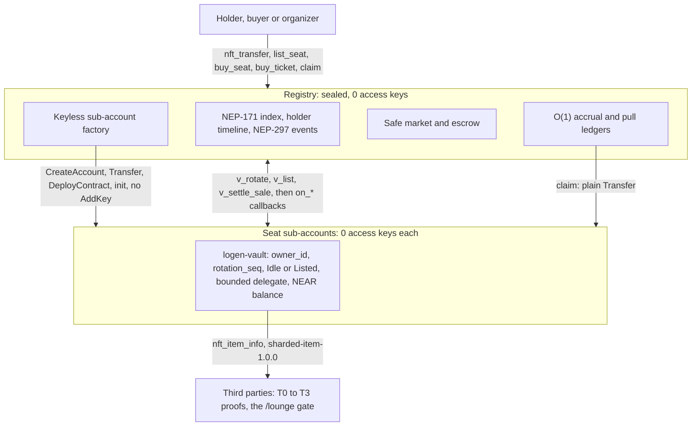

| Component | Contract or module | Role |
| --- | --- | --- |
| **Registry** (`logen-84b273.testnet`, sealed) | `logen-registry` | NEP-171 collection, keyless sub-account factory, accrual, safe market, escrow, pull ledgers |
| **Seat vault** (`sNNN.<registry>`) | `logen-vault` | Canonical owner, `rotation_seq`, listing state, bounded delegate, NEAR balance and outflows |
| **Core** | `logen-core` crate | Pure Rust state machines and overflow-safe math, shared by the contracts and the interleaving explorer |
| **Web** | `web/` (Next.js) | Wallet connect, dashboard, gate, history, market, Attack Lab |

Rule of thumb: **spend in the vault, move in the registry.** Withdrawals are called on the vault. Ownership changes go through the registry.

### How control passes on transfer and why the old owner cannot keep access

*(Track requirement R1)*

#### Step-by-step receipt flow (`nft_transfer`)

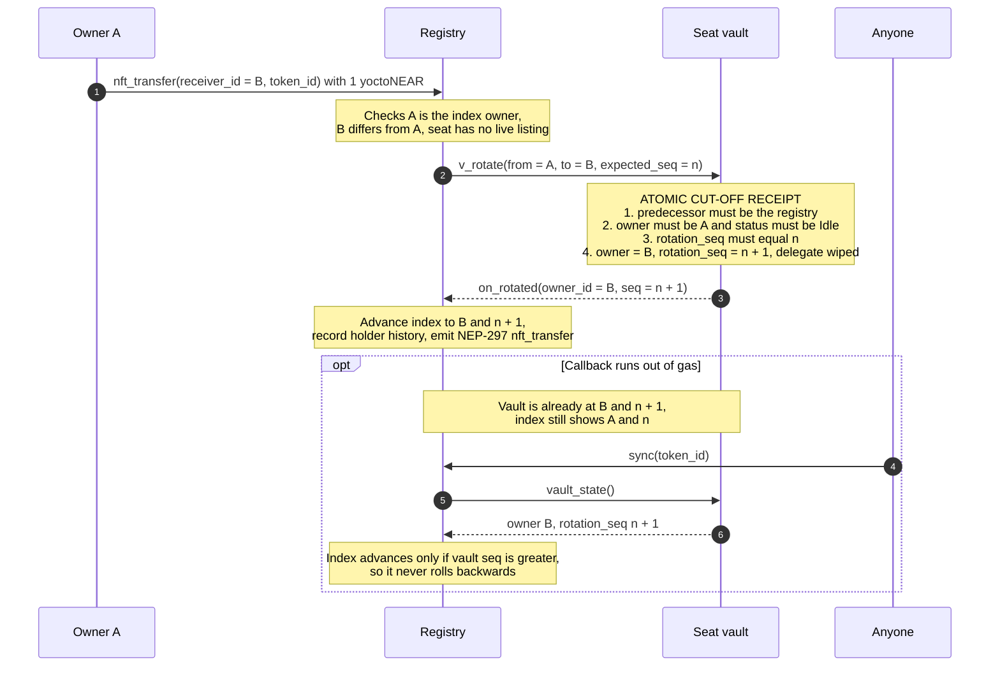

1. **Receipt 1 (`registry.nft_transfer`)**: Owner `A` calls `registry.nft_transfer(receiver_id = B, token_id)` attaching `1 yoctoNEAR`. The registry verifies that `A` is the current index owner, `B != A` (`E_SELF_TRANSFER`), and the seat has no live listing (`E_NOT_IDLE`).
2. **Receipt 2 (`vault.v_rotate`) — The Atomic Cut-Off**: The registry calls `vault.v_rotate(from = A, to = B, expected_seq = n)` on the seat sub-account. Inside this **single receipt**, the vault verifies:
   - `env::predecessor_account_id()` is its parent registry account derived from `env::current_account_id()` (`E_ONLY_REGISTRY`),
   - `vault.owner == A` (`E_NOT_OWNER`),
   - `vault.status` is `Idle` (expired listings are lazily normalized to `Idle`; active listings reject with `E_NOT_IDLE`), and
   - `vault.rotation_seq == n` (`E_WRONG_SEQ`).
   It then sets `vault.owner = B`, increments `vault.rotation_seq = n + 1`, and clears `vault.delegate = None`. **Control moves at this exact receipt.** Any subsequent call by `A` or `A`'s former delegate to the vault fails immediately.
3. **Receipt 3 (`registry.on_rotated` & `sync` healing)**: The callback updates the registry's NEP-171 index to `(B, n + 1)`, appends to the seat's holder timeline, and emits the NEP-297 `nft_transfer` event. If the callback ever runs out of gas, the vault is already at `(B, n + 1)` while the index is at `(A, n)`. Anyone can call `registry.sync(token_id)` (design decision `K8`), which reads `vault.vault_state()` and advances the index only when `vault.rotation_seq > index.seq` (never rolling backwards).

#### Six controls that stop a former owner from keeping access

| Vector Attempted by Seller | Why It Fails in Logen |
| --- | --- |
| **1. Keep a backup access key on the seat sub-account** | **Zero keys exist (`K1`)**: `mint_seat` creates the sub-account without `AddKey`, and `logen-vault` contains no `add_key` host call. `view_access_key_list` on every seat account is permanently `[]`. |
| **2. Use a parent `FullAccess` key to redeploy or drain** | **Sealed parent (`Segel`, `K1`/`K7`)**: The parent registry account has no upgrade/admin withdrawal methods and its access keys are deleted after setup. |
| **3. Appoint a pre-sale delegate (`set_delegate`) before transferring** | **Epoch-bound delegate**: Every `Delegate` stores the `rotation_seq` at which it was created, and `apply_rotation` sets `delegate = None`. Even if checked before clearing, `d.seq != self.rotation_seq` aborts with `E_STALE_DELEGATE` / `E_NO_DELEGATE`. |
| **4. Drain the vault while a buyer is purchasing (`buy_seat`)** | **Listing freeze (`E_FROZEN`) + Atomic Settlement**: Calling `list_seat` sets the vault to `Listed`, blocking all `withdraw`, `delegate_withdraw`, and `set_delegate` calls until canceled or expired. Furthermore, `v_settle_sale` verifies `withdrawable >= max(listing.min_balance, buyer.min_balance)` in the same receipt that transfers ownership. |
| **5. Cancel listing, drain vault, and relist at same price (`Bait-and-Switch`)** | **Monotonic `listing_nonce` (`E_NONCE_MISMATCH`)**: Every `v_list` increments `listing_nonce`. A buyer's `buy_seat(token_id, nonce, min_balance)` quotes the exact `nonce` they inspected; relisting increments the nonce and causes the in-flight buy to abort and refund the buyer. |
| **6. Keep an open web session to `/lounge` after selling** | **Per-request same-final-block Pair Check (`D1`/`D5`)**: The lounge session cookie embeds `{ accountId, tokenId, rotationSeq }`. Every `GET /api/gate/content` queries `registry.nft_token` and `vault.nft_item_info` at the **same final `block_id`** and rejects with `403` the moment `owner_id` or `rotation_seq` changes or diverges. |

### Safe sale

A seat carries money, so selling it needs protection that a plain NFT sale does not.

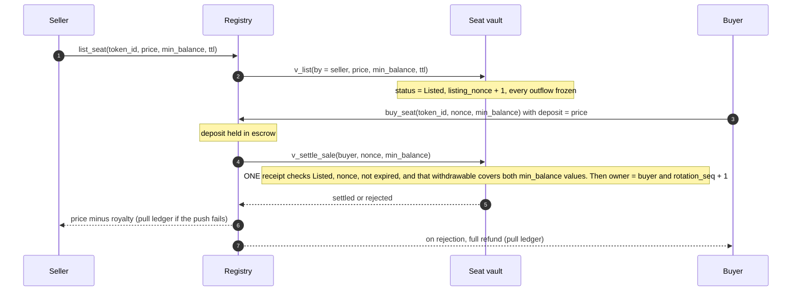

- **Freeze on listing.** `Listed` blocks `withdraw`, `delegate_withdraw` and `set_delegate` until the listing is cancelled, settled or expired.
- **Nonce.** Every `v_list` increments `listing_nonce`. A buyer quotes the nonce they inspected, so a cancel, drain and relist makes the in-flight buy abort and refund.
- **Balance guard.** `buy_seat` carries the buyer's `min_balance`. Settlement checks `withdrawable >= max(listing.min_balance, buyer.min_balance)` in the same receipt that changes the owner.
- **Check and act in one place.** The buyer does not verify and then act. The registry acts, and the checks and the ownership change share one receipt, because a pair check cannot stop ownership shifting between two receipts.

### Revenue sharing

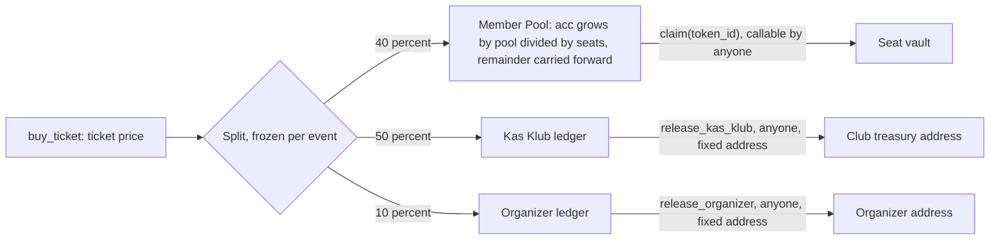

- One seat is one share. A global accumulator `acc` plus a per-token checkpoint gives **O(1) work per ticket**, with no loop over members.
- There is **no scaling factor**: a `10^24` factor would overflow `u128`. The division remainder is carried to the next ticket. If no seats exist yet, the pool share goes to the Kas Klub.
- `claim(token_id)` sets the checkpoint first, then sends a plain `Transfer` to the seat vault. Whoever holds the seat when the money lands owns it, so unclaimed accrual follows the token.
- Kas Klub and Organizer recipients are fixed at deploy time and have no setter.

### Design decisions

| ID | Decision | Why |
| --- | --- | --- |
| **K1** | **No access keys.** Seats are created by one atomic batch with no `AddKey`. Vault code never calls `add_key`, deploy or `delete_account`. The parent's keys are deleted after setup. | Removes plant-a-key and drain-before-sale attacks. The atomic batch leaves no front-run window for `init`. |
| **K2** | **Vault is canonical.** Owner, `rotation_seq`, listing state, delegate and balance live in the vault. The registry index may lag the vault but never lead it. | Who owns the seat and what it holds is decided in one receipt in one contract. |
| **K3** | **O(1) accrual without a scaling factor**, with remainder carry. | Overflow safety on `u128` and no per-member loops. |
| **K4** | **Balance travels with the token.** | The point of a wallet-NFT. It creates the need for the safe sale above. |
| **K5** | **Narrow surface.** No `nft_transfer_call`, no NEP-178 approvals, no free-form contract calls from the vault. | A rollback of `nft_transfer_call` would have to un-rotate a wallet the receiver may already have spent. |
| **K6** | **On-chain history.** Holder timeline, per-ticket `accrual_log` and claims in the registry. A 64-entry outflow ring buffer in the vault. NEP-297 events. | The History page works without an indexer. |
| **K7** | **Immutable.** No upgrade path. The registry pins the vault hash (`pin_vault_wasm`, locked after the first call). The parent is sealed. | Third parties can cache proofs, because nothing underneath can change. |
| **K8** | **Permissionless, forward-only `sync(token_id)`.** | Heals a lost callback without ever rolling ownership back. |
| **K9** | **Pure core.** State machines live in `logen-core` with no `near` dependency. Contracts are thin adapters. | The tests and the interleaving explorer run the same logic as the contracts. |
| **K10** | **Registry payouts are pull ledgers.** Refunds, failed proceeds, Kas Klub and Organizer shares are pulled by the recipient. | A failing push can never wedge contract state. |

---

## Threat model and Attack Lab

*(Track requirements R0 and R4)*

Every threat in [`docs/THREAT_MODEL.md`](./docs/THREAT_MODEL.md) maps to an invariant, a deterministic error code and an automated test. `make judge` runs the tests and `make attack` runs the exploit scenarios. Live testnet attempts for **A1, A2, A3 and A7** are linked in the [deployment table](#live-near-testnet-deployment). The other scenarios are covered by native contract tests and the interleaving explorer.

| ID | Attack Scenario | Architectural Control | Error Code / Outcome | Automated Test |
| --- | --- | --- | --- | --- |
| **A1** | Attacker or seller calls `vault.v_rotate` directly on seat sub-account | Vault derives parent registry from `env::current_account_id()` and checks `predecessor == registry` | `E_ONLY_REGISTRY` | `attack_a1_direct_v_rotate_bypass_blocked` |
| **A2** | Seller calls `vault.withdraw` while seat is listed on market | `v_list` freezes all vault outflows while listing is live | `E_FROZEN` | `attack_a2_seller_withdraw_while_listed_blocked` |
| **A3** | Seller cancels listing, drains vault, and relists with `min_balance = 0` | Monotonic `listing_nonce` checked in both `buy_seat` and `v_settle_sale` | `E_NONCE_MISMATCH` | `attack_a3_bait_and_switch_relist_blocked_by_nonce` & `s2_bait_and_switch_relist` (4,620 paths) |
| **A4** | Seller appoints an accomplice/bot via `set_delegate` before transfer/sale | Rotation wipes `delegate = None` and increments `rotation_seq` | `E_NO_DELEGATE` | `attack_a4_pre_sale_delegate_dies_on_transfer` |
| **A5** | Seller calls `registry.claim` hoping pool share goes to seller's wallet | `claim` always sends `Transfer` to `Promise::new(token_id)` (the seat vault) | `CREDITED_TO_VAULT_ONLY` | `unit_mint_event_ticket_and_claim_to_seat_vault` |
| **A6** | **Sale in the middle of a payout** (ticket + claim + buy + seller drain race) | Vault frozen during listing; payout lands in seat vault; buyer owns post-settlement balance | `E_FROZEN` / Buyer owns payout | `s1_sale_in_the_middle_of_a_payout` (75,600 paths) & `r4_sale_in_the_middle_of_a_payout_and_history_verification` |
| **A7** | Former owner calls `withdraw`, `set_delegate`, or `list_seat` after transfer | Canonical `owner_id` updated atomically in `v_rotate` / `v_settle_sale` | `E_NOT_OWNER` | `attack_a7_former_owner_withdraw_after_transfer_blocked` |
| **A8** | Vault balance is below seller's or buyer's `min_balance` guard at settlement | `v_settle_sale` checks `withdrawable >= max(seller_min, buyer_min)` and reverts; callback credits 100% pull refund | `E_INSUFFICIENT_BALANCE` | `attack_a8_min_balance_guard_rejects_and_refunds_buyer_in_full` |
| **A9** | Attacker calls `vault.init` again or tries to overwrite pinned `vault_wasm` | `#[init]` + parent check on vault; `pin_vault_wasm` locks permanently after first call | `E_UNSUPPORTED` / `E_ONLY_REGISTRY` | `unit_rejects_direct_v_rotate_from_attacker` |
| **A10** | Seller fires two concurrent `nft_transfer` calls (`double-transfer race`) | `v_rotate` checks `expected_seq == rotation_seq`; second receipt aborts | `E_WRONG_SEQ` | `s3_double_transfer_race` (180 paths) |
| **A11** | Callback runs out of gas leaving index behind vault; stale owner tries to act | `registry.sync(token_id)` heals index forward-only; gate fails closed while `vault.seq > index.seq` | `DIVERGENT_IGNORED` / Healed | `attack_a11_permissionless_sync_heals_lagging_index_and_never_rolls_back` & `s4_lost_callback_then_sync` |
| **A12** | `nft_transfer_call` rollback drain or seller buying own listing | `nft_transfer_call` is disabled (`K5`); self-buy rejected | `E_UNSUPPORTED` / `E_BUYER_IS_SELLER` | `unit_nft_transfer_call_is_disabled` |
| **D1–D5** | Web gate replay, forged key, stale session, or mid-transfer race on `/lounge` | Server-issued HMAC nonce challenge + Ed25519 NEP-413 verify + RPC `FullAccess` check + per-request same-final-block T2 pair check | `401` / `403` Fail-Closed | `web/src/lib/__tests__/logen.test.ts` |

---

## Web application

Next.js 16 App Router UI in `web/`. It runs against the testnet deployment by default. A demo switch swaps the chain adapter for an in-memory club, so every flow can be exercised without a wallet or a transaction.

| Route | Purpose |
| --- | --- |
| `/` | **Seat Wallet & Interactive 3D Vault**: View seat balance & withdrawable NEAR, configure or revoke an **Epoch-Bound Spending Delegate (`set_delegate` / `clear_delegate`)** scoped to `rotation_seq`, open the 5-row on-chain proof drawer (`VerifyDrawer`), withdraw funds, list/delist a seat, or simulate a live sale handoff (`HandoffOverlay`). Features the 3D-tilting `MascotPass` with orbital `Inside vault` reveal, interactive 12-seat glyph strip, and scroll-reactive 3D `AsciiVaultField` synced to the 3 core steps (`Seat`, `Vault`, `Handoff`). |
| `/events` | **Club Events & Ticket Pool (Track Requirement R1 & R3)**: Live upcoming/settled events, automatic member discount via `ticket_price_for`, instant 40% Member Pool / 50% Kas Klub / 10% Organizer revenue split on `buy_ticket`, ticket balance, and organizer event scheduling. |
| `/market` | **Safe Secondary Market**: Browse listed seats with spring-animated cards, inside-balance vs. asking-price comparison bars (`CompareBar`), and atomic `buy_seat` settlement. |
| `/mint` | **Mint Studio**: Drag-and-drop a portrait (PNG/JPEG/WebP, resized to 1200px), name the seat, choose an optional handle, preview the card, then mint in demo or live on NEAR Testnet. Live mints call `mint_seat` with the exact `seat_price` deposit and link to the explorer. |
| `/seats` | **Seat Directory**: Searchable, filterable roll of every seat with spring-staggered cards, inside balance, all-time earnings, holder, and status; links to each seat's history and to the Mint Studio. |
| `/lounge` | **Holder-Only Lounge (Track Requirement R2)**: Gated by NEP-413 challenge signature + single-use replay protection + RPC `FullAccess` check + per-request same-final-block T2 pair check (`/api/gate/{challenge,verify,content}`). |
| `/treasury` | **Club Treasury & Pull Ledgers**: Complete club economics inspection (O(1) member pool accumulator `acc`, Kas Klub treasury owed/released, organizer owed/released, 5% secondary royalty feed, and permissionless `release_*` execution). |
| `/seat/[id]` | **Per-Seat History (Track Requirement R3)**: Monthly ledger of **All**, **Earned** (event pool shares), **Paid out** (vault outflows), and **Holders** (ownership timeline with `rotation_seq` & acquisition type). |
| `/verify` | **On-Chain Proof Verifier**: Interactive 5-row verification table checking `Access keys (0)`, `Pinned code hash`, `Same-block identity pair-check`, `Canonical holder`, and `Registry seal status (SEALED 0 KEYS)` with spring-staggered re-check animations. |
| `/lab` | **Interactive Attack Lab & Visual Race Simulator (Track Requirement R4)**: Test all 12 seller & gate exploit scenarios (`A1–A12`) via the interactive Defense Matrix, and run the 3-step animated receipt race simulator (`Payout mid-sale`, `Bait & switch`, `Lost callback`). |
| `/kit` | Design system specimens: tokens, type, controls, glyphs, pixel chair, mascot portrait, uploaded-portrait card and state primitives. |

**How the `/lounge` gate works**

1. `/api/gate/challenge` issues a single-use nonce signed with a server HMAC.
2. The wallet signs the challenge with NEP-413.
3. `/api/gate/verify` checks the Ed25519 signature, consumes the nonce (replay protection) and confirms through RPC that the signing key is a `FullAccess` key of the claimed account. It then issues a session cookie bound to `{ accountId, tokenId, rotationSeq }`.
4. Every `/api/gate/content` request reads `registry.nft_token` and `vault.nft_item_info` at the **same `final` block** and returns `403` if the owner or `rotation_seq` changed, or if the two disagree. A missing or invalid session returns `401`. The gate fails closed while the index lags the vault.

### Mint Studio: upload → seat NFT

`/mint` is the member-facing mint flow. It works in two modes:

- **Demo** (`?demo=1` or the DEMO switch): `MockChain.mintSeat` creates a seat in memory with the uploaded portrait, name, story and handle. Nothing is sent on chain; reset demo clears it.
- **Live** (demo off, wallet connected): the page calls `registry.mint_seat({ receiver_id, handle })` with a deposit exactly equal to `config.seat_price` (2.2 NEAR on the current testnet deployment) and 220 Tgas. The contract creates `<handle>.<registry>` as a keyless sub-account, deploys the pinned vault code, and registers the NFT. The page waits for the index, opens the success sheet, and offers an explorer link.

Portrait storage is intentionally honest: the uploaded image is compressed to WebP, capped at 1200px, and kept in the browser (`localStorage` for live seats, in-memory for demo). The NFT's on-chain `metadata.media` remains the dynamic Logen SVG generated by the contract. The uploaded portrait is a display layer for this browser; it is not written on chain, because `mint_seat` has no media argument and the contract's metadata is generated from seat state. The mint sheet says so before and after the transaction.

Handle rules match the contract: 2–20 lowercase `[a-z0-9-]` characters, no leading or trailing hyphen, and no `s<digits>` prefix (reserved for numbered seats). A live mint requires a handle so the new token id is known immediately; demo mints can leave it blank and receive the next numbered seat.

### Design, Bit-07 Robot Pet & ASCII Spell Motion

- **Interactive Sentient Robot Pet (`LogenWizardCompanion.tsx`)**: A pixel-accurate, expressive replica of **Bit-07** — the floating winged cube robot from `logen-mascot.png` (beveled white/ice-blue chassis, pointed ears with glowing cyan cores, dark CRT face with cursor-tracking cyan pixel eyes and expressive mouth across 8 emotions, flapping cyan pixel wings, kicking feet, and glowing cyan orbital swirl underneath):
  - **Autonomous Sentience & Roaming**: Roams autonomously on a calm patrol loop (`Roam` / `Stay` toggle), tracks the user's cursor in real time, reacts to pokes/tickles, and adapts its knowledge to every route.
  - **Pick Up, Drop-to-Scan & Element Inspector**: Grab and lift the robot anywhere on the screen (`lifted` wide-eyed expression) and drop it onto any card, button, or Attack Lab row (`A1`–`A12`) to automatically scan, explain, or zap that element—or click **`Scan Elemen`** to click-inspect any part of the UI.
  - **Ask-Anything Bilingual Knowledge Brain**: Includes an interactive chat input (`Tanya apa saja ke Bit-07…`) and instant topic chips (`Apa itu Logen?`, `Kenapa 0 Keys?`, `Cara Kerja Market`, `12 Serangan Lab`, `Bagi Hasil O(1)`, `Pintu Lounge`) that explain every architectural mechanism in plain language alongside 1-click contextual page actions (`Summon Demo`, `Sambar Semua 12!`, `Re-check Semua 5`, `Isi Nama Otomatis`, `Sorot Kursi Terbaik`).
- **ASCII Spell Engine (`AsciiSpellEngine.tsx` & `AmbientBackdrop.tsx`)**:
  - **Calm when idle, magical on scroll & transition**: A full-viewport HTML5 canvas (`AsciiSpellCanvas`) stays completely quiet while reading and awakens with rising arcane ASCII runes (`· ∘ ∶ ⊹ ✦ ✧ ⟡ ⊞`) when scrolling, switching pages (`AsciiPageTransition`), or triggering feature spells (`castAsciiSpell`).
  - **Rune-Weaving Typography (`AsciiSpellText` & `AsciiRuneDivider`)**: Section headings materialize by decoding through ASCII runes (`· ∘ ⊹ ✦ ✧`) on scroll or tab switch, separated by scroll-reactive ASCII rune threads.
- **Mascot Pass & Orbital Vault Reveal (`MascotPass.tsx`)**: `web/public/logen-mascot.png` is the original pixel-art cybernetic wizard. `MascotPass` turns the mascot into a 3D pointer-tilting credential with spring-animated seat numbers/balances and an orbital **`Inside vault`** reveal (`Locked inside: 3.20 NEAR` + `0 Keys`, `Pinned Code`, `1-Step Handoff`).
- **Scroll-Reactive 3D ASCII Vault (`AsciiVaultField.tsx`)**: Renders a 60fps HTML5 canvas 3D ASCII projection (`Seat`, `Vault`, and `Handoff`) that rotates smoothly with page scroll and morphs between shapes via cell-by-cell Restipple wave transitions (`⊞` / `▪`).
- **Calm Atmospheric Horizon Footer (`SiteFooter.tsx`)**: Combines clean 2-column navigation with an interactive `Cobalt glow` / `Obsidian glow` stippled horizon backdrop. Every animation respects `prefers-reduced-motion: reduce`.

### Screenshots & Visual Walkthrough

Live deployment: **[https://logen-seat-tan.vercel.app/](https://logen-seat-tan.vercel.app/)**

| Seat Wallet (`/`) | Mint Studio (`/mint`) |
| :---: | :---: |
| 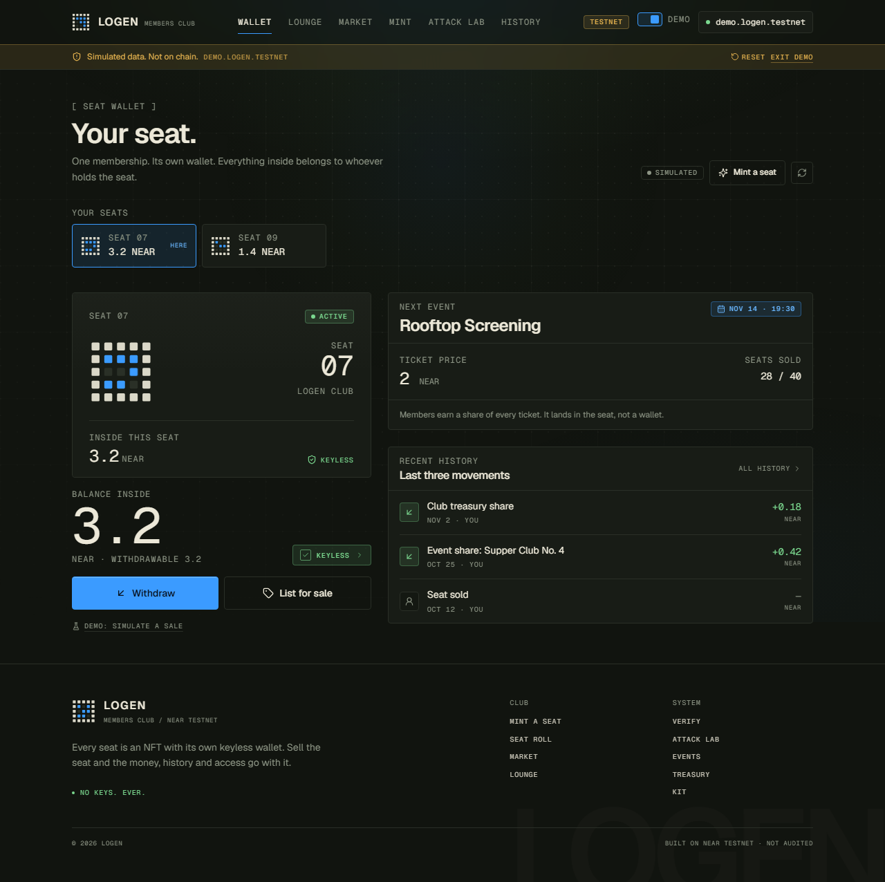 | 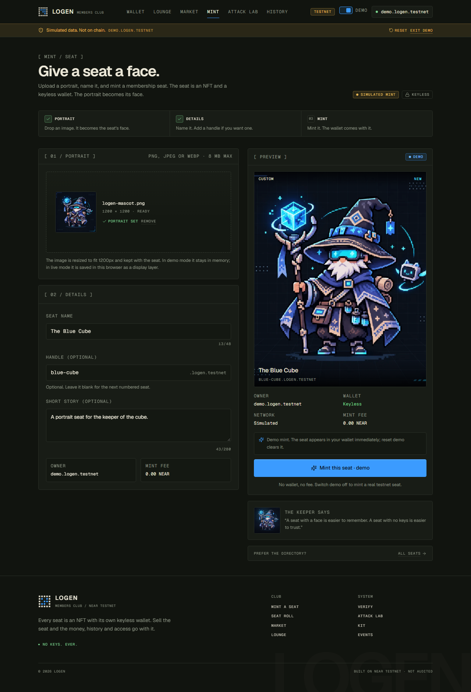 |
| **Safe Secondary Market (`/market`)** | **Holder-Only Lounge (`/lounge`)** |
| 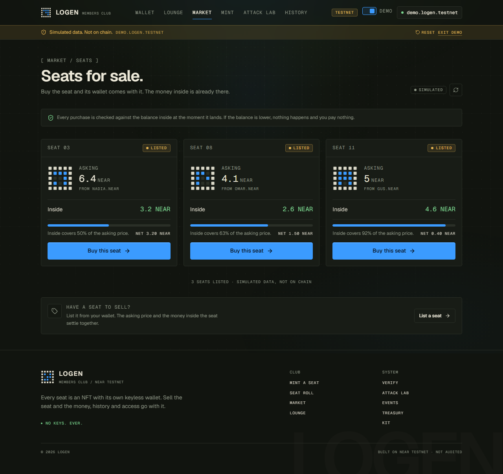 | 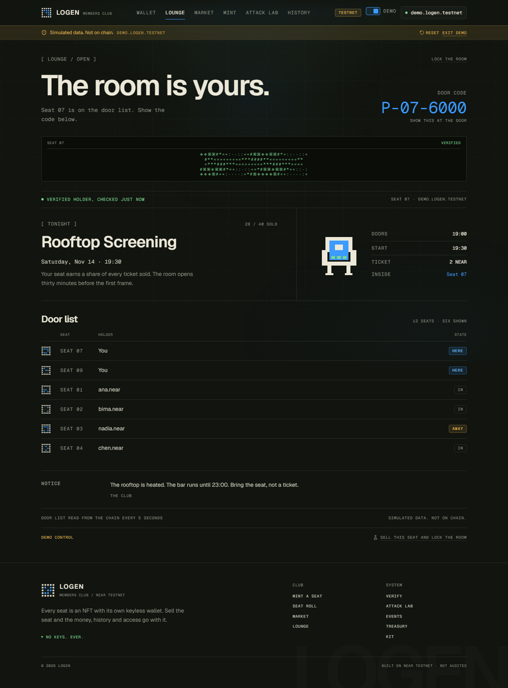 |
| **Attack Lab (`/lab`)** | **5-Row On-Chain Proof Verifier (`/verify`)** |
| 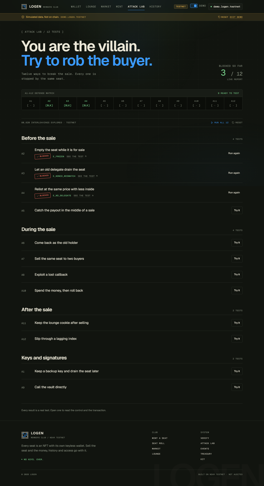 | 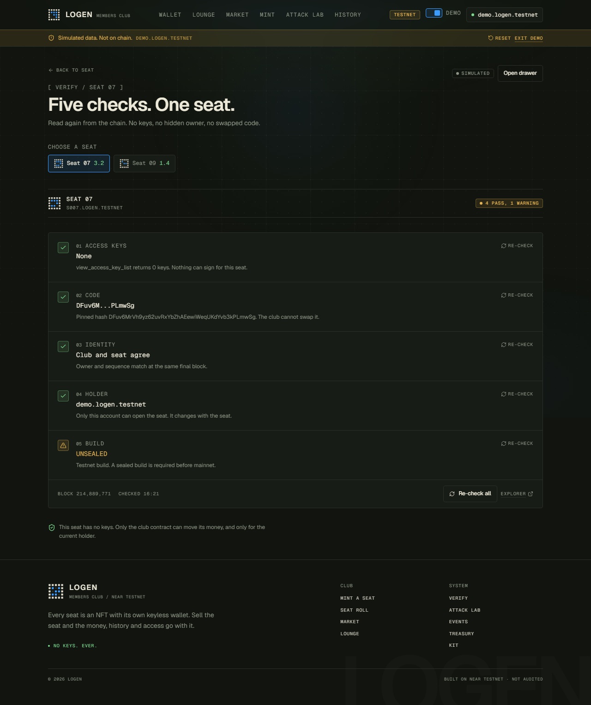 |

`web/screenshots/` is generated with `node scripts/capture.mjs <scenario> <width> <height>`:

- `landing-{390,768,1280}.png` — connect screen, 3D-tilting member pass, interactive 12-seat glyph roll, 3D Seat Throne ASCII Vault Field, and On-Chain Flow
- `mint-{empty,filled,success}-{390,768,1280}.png` — Mint Studio, portrait drop, preview and success sheet
- `home-{390,768,1280}.png`, `market-{390,768,1280}.png`, `seats-{390,768,1280}.png` — wallet, market and the full seat directory
- `seat-{390,768,1280}.png`, `verify-{390,768,1280}.png`, `verify-drawer-*`, `kit-{390,768,1280}.png` — seat history, proof verifier and design specimens
- `market-sheet-*` and `handoff-*` — buy confirmation and post-purchase handoff overlays
- `lounge-{closed,open,locked}-{390,768,1280}.png` and `lab-*` — responsive Lounge and Attack Lab states

Checked routes score 100 for accessibility, best practices and SEO in Lighthouse. Keyboard focus is visible, the buy sheet traps Tab and closes on Escape, and `prefers-reduced-motion: reduce` disables the mascot, glyph, skeleton and page transitions.

---

## Repository layout and build artifacts

```text
logen/
├── Makefile                  # make judge | make attack | make docker-judge
├── Cargo.toml                # Rust workspace (logen-core, logen-test-env, vault, registry)
├── LICENSE                   # MIT
├── .github/workflows/        # CI workflows
├── docker/                   # Pinned rust:1.86-bookworm image used by make docker-judge
├── crates/
│   ├── logen-core/          # Pure, dependency-free state machines & overflow-safe math (#![forbid(unsafe_code)])
│   │   ├── src/
│   │   │   ├── accrual.rs    # O(1) member pool accumulator with carry (no scaling-factor overflow)
│   │   │   ├── index.rs      # Forward-only registry index, listing mirror, sync & T2 pair_check()
│   │   │   ├── math.rs       # Overflow-safe apply_bps(u128, u16) for all u128 values
│   │   │   ├── split.rs      # Per-event frozen revenue split (40% Pool, 50% Kas Klub, 10% Organizer)
│   │   │   └── vault.rs      # Canonical VaultCore state machine (Idle/Listed, nonce, delegate, rotate, settle)
│   │   └── tests/
│   │       └── interleavings.rs # Exhaustive receipt-interleaving explorer (80,000+ schedules)
│   └── logen-test-env/      # Cross-platform in-memory NEAR host runtime for native cargo test on Windows/macOS/Linux
├── contracts/
│   ├── vault/                # Per-seat sub-account smart contract (sharded-item-1.0.0 + outflows ring buffer)
│   └── registry/             # Parent NEP-171 collection, keyless sub-account factory, accrual, safe market & pull ledgers
├── tests/
│   └── sandbox/              # Level L1 near-workspaces local validator sandbox tests (Linux / Docker)
├── scripts/
│   ├── logen-cli.mjs        # One-command judge runner (`make judge`, `make attack`, `verify-live`)
│   └── deploy-testnet.mjs    # Pure-Node Ed25519 + Borsh NEAR Testnet provisioner, deployer & live attack runner
├── docs/
│   ├── API.md                # Complete contract JSON interface & error code reference
│   ├── THREAT_MODEL.md       # Formal invariants (I1-I7) and Threat Model (A1-A12, D1-D5)
│   └── deployment.testnet.json # Live NEAR Testnet account IDs, code hashes & transaction hashes
└── web/                      # Next.js 16 App Router UI (Seat Wallet, Lounge, Safe Market, History, Proof Verifier, Attack Lab)
    ├── screenshots/          # Captured desktop & mobile UI states across all routes
    ├── scripts/capture.mjs   # Automated screenshot capture script
    └── src/
        ├── app/              # App Router pages (/, /mint, /lounge, /market, /seat/[id], /verify, /lab, /events, /seats, /treasury, /kit)
        ├── components/       # Seat cards, glyphs, mascot, uploaded portraits, proof drawer, sheets, handoff overlay & primitives
        └── lib/              # Chain hooks, DemoProvider, image/portrait stores, NEP-413 verifier, T2 pair-check, RPC client & Vitest suite
```

### Compiled artifacts

Built with Rust `1.86.0`, target `wasm32-unknown-unknown`, `opt-level = "z"`, `lto = true`, `strip = "symbols"`.

| Contract | Binary Path | Size | SHA-256 Code Hash (Base58) |
| --- | --- | --- | --- |
| **`logen-vault`** | `target/wasm32-unknown-unknown/release/logen_vault.wasm` | `189,825 B` | `4MMm6JjN8YiGcx11EJoNejVZGeZEpeGXU4Ak32FhZUk3` |
| **`logen-registry`** | `target/wasm32-unknown-unknown/release/logen_registry.wasm` | `461,731 B` | `FPpB17WxWJMdyW4ncP4F33n6FjFd18Livp7t6BgsHCem` |

---

## Third-party verification ladder

Logen implements the four-tier verification ladder from the [Sharded NFT Items draft](https://github.com/houseofstake/tla-contracts/blob/main/docs/sharded-nft-items.md):

- **T0 (Namespace)**: A seat ID `<label>.<registry>` is a direct sub-account of `<registry>`, which only `<registry>` could create.
- **T1 (Index)**: `registry.nft_token({ token_id })` reports the collection's view of `owner_id`.
- **T2 (Pair Check)**: At a single `final` `block_id`, a consumer reads both `registry.get_seat({ token_id })` and `vault.nft_item_info()` on `<token_id>`. Both must agree on `owner_id` and `rotation_seq` (and `collection_id` is pinned from the consumer's config, never trusted from the item).
- **T3 (Keyless & Provenance Proof — *Bukti Tanpa Kunci*)**: RPC `view_access_key_list` on `<token_id>` has `keys.length === 0`, `view_account` matches `get_config().vault_code_hash`, and the parent `<registry>` is sealed.

---

## Limitations and scope

Stated plainly so reviewers do not have to discover them:

- **Testnet only.** Nothing is deployed to mainnet and the contracts are **not audited**.
- **Draft standard.** Sharded NFT Items is a draft, not a final NEP. Logen pins the `sharded-item-1.0.0` string and does not depend on any deployed registry from that draft.
- **Immutability has a price.** There is no upgrade path, no admin and no recovery (K7). A bug in a deployed vault cannot be patched. A fix means a new registry.
- **The balance moves with the seat (K4).** Buyers should set `min_balance`. The market shows the balance inside the seat next to the asking price.
- **The gate fails closed.** Right after a transfer, while the index lags the vault, `/lounge` denies access until the callback lands or someone calls `sync`. Availability is traded for safety.
- **Narrow NFT surface (K5).** No `nft_transfer_call` and no NEP-178 approvals, so third-party marketplaces that rely on approvals cannot list seats. Logen's own market is the sale path.
- **Demo mode is sample data.** The **Demo** toggle shows the UI with in-browser sample data and does not read chain state.
- **Sandbox needs Linux.** The L1 `near-workspaces` tests need Linux or Docker. L0 and LM tests run natively on any OS.

---

## Roadmap

Ideas that are **not part of this submission**:

- Mainnet deployment after an external audit.
- NEP-199 payout royalties for sales on third-party marketplaces.
- A Founder tier of seats.
- Bounded spending allowances so an AI agent can act for a seat holder without holding any key.
- Kas Klub held in a Sputnik DAO or Trezu treasury.
- Arisan on-chain: a rotating-savings club where a seat is a turn plus a balance.

---

## Hackathon compliance and disclosures

| Item (from [HACKATHON.md](https://nearhackathon.com/HACKATHON.md)) | Logen |
| --- | --- |
| Public repository | https://github.com/chenn19I/Logen |
| License file (Q-014) | MIT, see [LICENSE](./LICENSE) |
| Code written in the window (Q-001, Q-004) | New project. The contracts, tests and web app were written during the hackathon window. There is no pre-hackathon baseline. |
| Existing product on another chain (Q-002) | None |
| Testnet-only and integrations (Q-010, Q-011) | Testnet deployment. Own contracts on NEAR that fit the track, no mandatory integration. |
| Reproducible README for AI screening (Q-017) | See [Verify it yourself](#verify-it-yourself) |
| Hosted demo (Q-012) | https://logen-seat-tan.vercel.app/ on Vercel. HACKATHON.md asks for it to stay up through 2026-11-18. |
| Libraries, templates and AI code (Q-005) | See the disclosure below |
| Track | `nfts` |

<!-- TODO before submitting: add a "Demo post on X" row to the table above with the public post URL. -->

### Disclosure of libraries, templates and AI tooling (Q-005)

All Logen smart contracts (`logen-core`, `logen-vault`, `logen-registry`), the receipt-interleaving explorer, the NEP-413 + T2 pair-check gate, and the web application were built from scratch during the NEAR Hackathon window (Nov 2026).

- **Open-source libraries used**:
  - Rust: `near-sdk` (`5.9.0`), `borsh` (`1.x`), `serde` (`1.x`), `serde_json` (`1.x`), `near-workspaces` (`0.16`, dev/sandbox).
  - Web / TypeScript: `next` (`16.4.5`), `react` (`19.3.1`), `@tanstack/react-query` (`5.106.0`), `@near-wallet-selector/*` (`8.9.15`), `near-api-js` (`5.0.1`), `@radix-ui/react-dialog` (`1.3.1`), `@radix-ui/react-switch` (`1.4.1`), `@radix-ui/react-tabs` (`1.2.1`), `framer-motion` (`14.9.1`), `tweetnacl` (`1.0.3`, Ed25519 verification), `lucide-react` (`0.460.0`), `tailwindcss` (`3.4.17`), `vitest` (`2.1.8`).
- **Design reference**: The `nft_item_info()` view structure (`spec: "sharded-item-1.0.0"`) and T0–T3 verification ladder follow the public [Sharded NFT Items draft](https://github.com/houseofstake/tla-contracts/blob/main/docs/sharded-nft-items.md) linked in Track 10 (`10-nfts.md`). No code was copied from `tla-contracts`.
- **AI coding tools**: Built with assistance from Claude / Gemini in Antigravity IDE for pair-programming, test generation, and UI implementation.

---

## Glossary

Logen keeps a few Indonesian terms from its original design.

| Term | Meaning |
| --- | --- |
| **Logen** | An heirloom handed down together with what it contains. That is the seat's behavior: it changes hands and the wallet and rights go with it. |
| **Seat** | The NEP-171 NFT and its sub-account, as one thing. |
| **Vault** | The `logen-vault` contract running on each seat sub-account. |
| **Segel** (Segel Induk) | The seal: the parent registry account with all access keys deleted. |
| **Bukti Tanpa Kunci** | "Keyless proof": the verification badge showing a seat has zero access keys. |
| **Kas Klub** | Club treasury. Receives 50% of ticket revenue by default. |
| **Pool Anggota** | Member Pool. Receives 40% of ticket revenue by default, shared per seat. |
| **Attack Lab** | The set of seller and gate exploit scenarios, runnable from the CLI and shown on `/lab`. |

---

## License

Released under the [MIT License](./LICENSE). Author: [@chenn19I](https://github.com/chenn19I).
